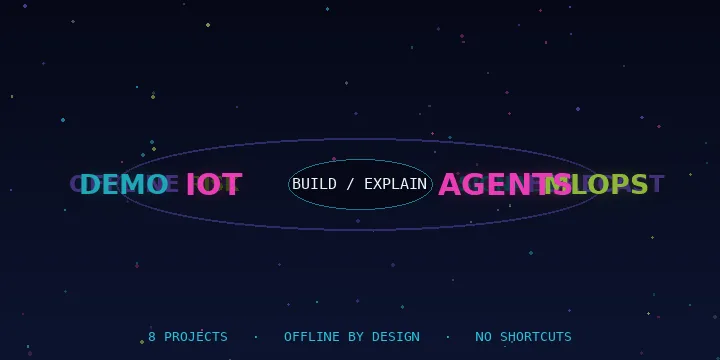
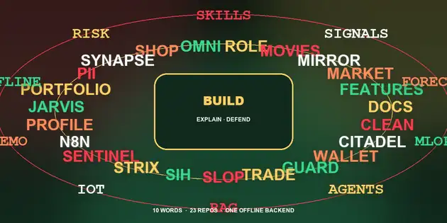
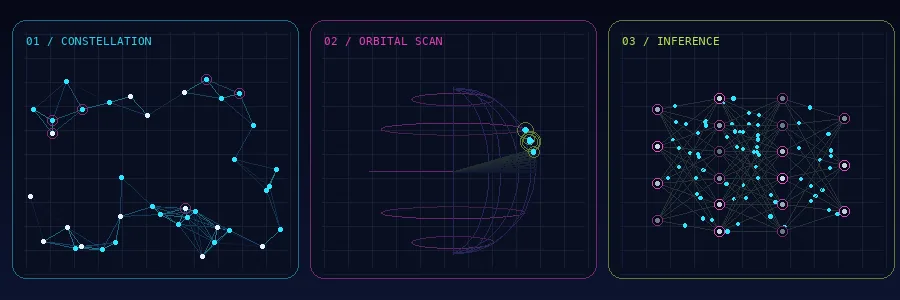

# Mayank Jain


    

2nd Year EEE student in Bangalore. Backend & data analytics.
Most of my public work is TypeScript.


##  Featured — AI/ML portfolio

<p align="center">
  
</p>

<p align="center">
  
</p>


Eight self-contained projects — agents, retrieval, drift detection, disaster
forecasting and an IoT command platform — built from scratch so every design
decision is mine to explain. Every one runs fully offline in demo mode.
**[Explore the portfolio](https://github.com/mayankjain1815-commits/ai-ml-portfolio)**
or open the **[3D landing page](https://github.com/mayankjain1815-commits/ai-ml-portfolio/blob/main/index.html)**.

<p align="center">
  
</p>

**Three hand-written canvas systems:**

- **Particle constellation** — depth-projected nodes, proximity links and cursor parallax.
- **Threat globe** — wireframe lat/lon sphere, radar sweep and six pulsing sensor positions.
- **Activation graph** — signals crossing weighted 4→6→6→3 layers with activation pulses.

No WebGL, no libraries, no external assets. The **aurora neon** palette — obsidian
navy, electric cyan, hot magenta, acid lime, violet and ice white — carries across
the portfolio, the landing page and these animations. The landing page also has a
**Christmas toggle**: the same three systems switch to tree green, bauble red and
gold with falling snow, and the choice survives reloads. GitHub strips `<script>`
and `<canvas>` from Markdown, so these are animated WebP recordings; the
interactive versions live on the landing page.

The landing page now rotates **two** rings: ten concept words and a counter-rotating
inner ring of **23 public repositories**. Clicking a word or a repo opens its full
record — definitions and real code anchors for words; stack, highlights, linked
words and a clone command for repos — served by a small
[Flask word atlas](https://github.com/mayankjain1815-commits/ai-ml-portfolio/blob/main/backend/README.md)
with cross-ring search, live stats and an embedded offline fallback.


##  Live status — `Bhushan2318/sih-main`

         

Every badge above is a **live** [shields.io](https://shields.io) endpoint that queries
GitHub when the image is rendered — none of them are values I typed in.

##  SIH 2026 — district-level weather forecast verification

**[sih-main](https://github.com/Bhushan2318/sih-main)** — predicts where India's medium-range
weather forecasts will bust, district by district, and explains why with SHAP.
XGBoost + FastAPI + React. **Selected for the national round of Smart India
Hackathon 2026**, problem statement 26079 (Ministry of Earth Sciences). Python.

     


##  Languages across all public repositories

Measured from the GitHub languages API across all 18 non-fork, non-archived public
repositories (186,875,056 source bytes). Shares are by bytes, not by file or line
count.

| Language | Share | Bytes |
|----------|------:|------:|
|  | 85.0% | 158,904,122 |
|  | 4.2% | 7,860,340 |
|  | 3.4% | 6,266,659 |
|  | 3.1% | 5,829,544 |
|  | 2.7% | 4,982,070 |
|  | 1.0% | 1,840,229 |
|  | 0.2% | 368,150 |
|  | 0.2% | 347,015 |

Reproduce it:

```sh
gh api graphql -f query='{ user(login: "mayankjain1815-commits") { repositories(first: 100, privacy: PUBLIC, ownerAffiliations: OWNER, isFork: false) { nodes { isArchived languages(first: 100, orderBy: {field: SIZE, direction: DESC}) { edges { size node { name } } } } } } }' \
  --jq '[.data.user.repositories.nodes[]
          | select(.isArchived | not)
          | .languages.edges[] | {name: .node.name, size: .size}]
         | group_by(.name)
         | map({name: .[0].name, bytes: (map(.size) | add)})
         | sort_by(-.bytes)'
```

##  Measured snapshot

Taken 2026-09-26 from the GitHub REST/GraphQL APIs. Unlike the badges, these are
point-in-time and will drift.

| Metric | Value |
|--------|-------|
| Public repositories | 18 non-fork, non-archived |
| Languages present | 25 |
| Source size measured | 186,875,056 bytes |
| Merged PRs into OmniRoute | 6 |
| Stars across all repositories | 0 |

##  All public repositories

| Repository | Primary language | Last commit |
|------------|------------------|-------------|
| [`Agent-Memory-Guard`](https://github.com/mayankjain1815-commits/Agent-Memory-Guard) | `Python` |  |
| [`Agent-Wallet-SDK`](https://github.com/mayankjain1815-commits/Agent-Wallet-SDK) | `TypeScript` |  |
| [`AI-Slop-Detector`](https://github.com/mayankjain1815-commits/AI-Slop-Detector) | `Python` |  |
| [`AI-Trading-Bot`](https://github.com/mayankjain1815-commits/AI-Trading-Bot) | `HTML` |  |
| [`CITADEL`](https://github.com/mayankjain1815-commits/CITADEL) | `JavaScript` |  |
| [`Doclify`](https://github.com/mayankjain1815-commits/Doclify) | `Python` |  |
| [`Feature-Engine`](https://github.com/mayankjain1815-commits/Feature-Engine) | `Python` |  |
| [`Marketinsight`](https://github.com/mayankjain1815-commits/Marketinsight) | `Python` |  |
| [`mayankjain1815-commits`](https://github.com/mayankjain1815-commits/mayankjain1815-commits) | — |  |
| [`MirrorGPT`](https://github.com/mayankjain1815-commits/MirrorGPT) | `Python` |  |
| [`Movie-Recommendation-System`](https://github.com/mayankjain1815-commits/Movie-Recommendation-System) | `Jupyter Notebook` |  |
| [`n8n`](https://github.com/mayankjain1815-commits/n8n) | `TypeScript` |  |
| [`Next-Role`](https://github.com/mayankjain1815-commits/Next-Role) | `Python` |  |
| [`OmniRoute`](https://github.com/mayankjain1815-commits/OmniRoute) | `TypeScript` |  |
| [`ShoppingGPT`](https://github.com/mayankjain1815-commits/ShoppingGPT) | `HTML` |  |
| [`strix`](https://github.com/mayankjain1815-commits/strix) | `Python` |  |
| [`Synapse`](https://github.com/mayankjain1815-commits/Synapse) | `Python` |  |
| [`TrustBoost-PII-Sanitizer`](https://github.com/mayankjain1815-commits/TrustBoost-PII-Sanitizer) | `HTML` |  |


## How to read these badges

- **setup**, **Train** and **Refresh** track the most recent completed run of those
  three workflows on the **default branch** (`main`) — they describe `main`, not a
  pull request. All three use `github/actions/workflow/status`, which reads the
  latest completed run; the older `github/workflow/status` endpoint is broken
  upstream and is not used here. `sih-main` runs seven workflows; only these three
  are shown, to keep the line readable.
- **Last commit**, **commit activity**, **open issues**, **contributors**, **repo
  size**, **top language** and every per-repository badge are queried from GitHub
  each time the image is fetched, so they stay current on their own.
- Workflows that have never completed a run on the default branch are **omitted**
  rather than shown as "no status", which would misrepresent them.
- Star badges are omitted on purpose for the repositories in the table above: each
  has 0 stars, so the badge would add noise. `sih-main` does carry a star badge,
  because it has real stars.

## License

[MIT](LICENSE) — see the file for the full text.
